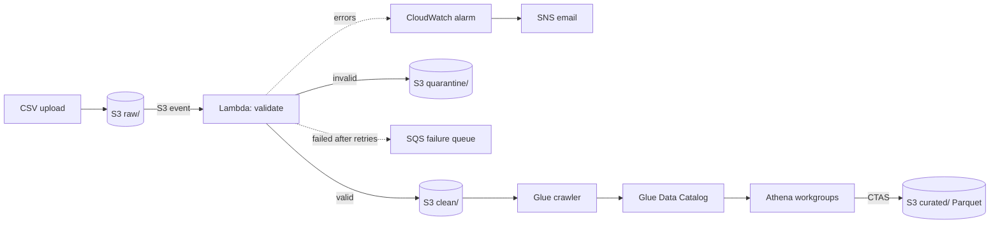

# NYC Taxi Data Lake on AWS

A serverless data pipeline on AWS that ingests, validates, catalogs and serves NYC taxi trip data.
Built hands-on, one layer at a time, while preparing for the AWS Certified Data Engineer – Associate (DEA-C01) exam.

**Status:** in progress · 3 of 16 builds complete · Region `us-east-1`

## Architecture



## Builds

| # | Build | Services | Result |
|---|---|---|---|
| 1 | [Data Lake Zones and Tiering](builds/01-data-lake-zones/) | S3 | Zoned, partitioned, versioned lake with lifecycle tiering |
| 2 | [Event-Driven File Validation](builds/02-event-driven-validation/) | S3, Lambda, SQS, CloudWatch, SNS | Files validated on arrival; failures captured and alerted |
| 3 | [Schema Catalog and SQL Analytics](builds/03-schema-catalog-sql/) | Glue, Athena | Cataloged lake; Parquet cut data scanned up to 100x; partition projection |

**Coming next:** real-time streaming (Kinesis) ·
database change capture (DMS) · ETL with data quality (Glue) · orchestration (Step Functions) ·
data warehouse (Redshift Serverless) · pipeline as code (SAM) · governance and PII (Lake Formation).

## Skills shown

- **Data lake design:** zones, Hive-style partitions, storage tiering based on access patterns
- **Event-driven pipelines:** S3 notifications, Lambda, async retries, failure destinations
- **Data quality:** schema and row-count checks with a quarantine path
- **Security:** least-privilege IAM roles scoped to S3 prefixes; encryption at rest; no access keys
- **Operations:** CloudWatch alarms, SNS alerts, debugging timeouts and memory starvation
- **Query optimization:** columnar formats, partitioning, partition projection, workgroup scan limits
- **Cost control:** lifecycle rules, right-sized Lambda memory, budgets, teardown after each build

## Repo layout

```
builds/     one folder per build: README, code, IAM policies, screenshots
scripts/    helpers (sample data generator)
```

## Reproduce

1. AWS account with an admin role, AWS CLI v2, Python 3.12 with `pandas` and `pyarrow`.
2. Download sample data from the [NYC TLC trip record page](https://www.nyc.gov/site/tlc/about/tlc-trip-record-data.page) into `data/`.
3. `python scripts/make_csv_sample.py 2024-01` makes a 200,000-row CSV sample.
4. Follow each build's README in order. Hourly resources are torn down at the end of each build.
