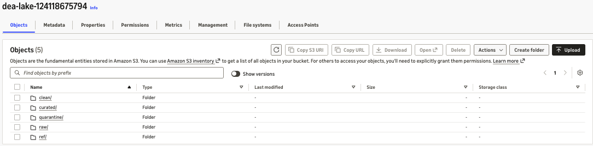
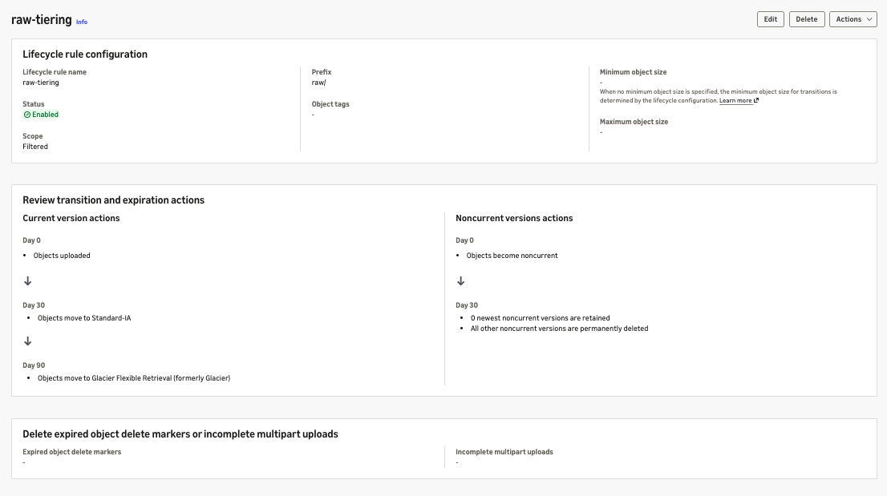
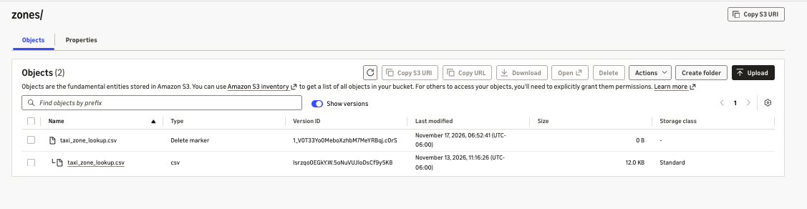

# Build 1: Data Lake Zones and Tiering (S3)

Set up the S3 data lake that every later build uses: one bucket split into zones,
Hive-style partitions, lifecycle tiering, and versioning for recovery.

## What I built

| Item | Setting |
|---|---|
| Lake bucket | `dea-lake-<account-id>` · versioning on · SSE-S3 with Bucket Key · public access blocked |
| Zones | `raw/` · `clean/` · `quarantine/` · `curated/` · `ref/` |
| Partitions | `raw/trips/year=2024/month=01/` |
| Lifecycle | `raw/`: Standard-IA at 30 days, Glacier Flexible Retrieval at 90 · `quarantine/`: expire at 14 days |
| Query results bucket | `dea-athena-<account-id>` (used from Build 3) |

## Design decisions

| Decision | Why |
|---|---|
| Separate zones | Keep untouched input, validated data and failures apart; each zone gets its own rules |
| `key=value` partitions | Glue and Athena read them as columns and skip folders a query doesn't need |
| Lifecycle rule, not Intelligent-Tiering | Access pattern is known (hot 30 days, then cold), so a free rule beats a monitoring fee |
| Small files stay in Standard | Standard-IA bills a 128 KB minimum and 30 days; tiering tiny files would cost more |
| Versioning on | Deletes and overwrites are reversible |

## What broke (on purpose)

Deleted a reference file. With versioning on, S3 added a delete marker on top of the original
instead of removing it. Deleting only the marker restored the file with the same version ID.

## Cost

Pennies: about 20 MB stored, no hourly resources.
