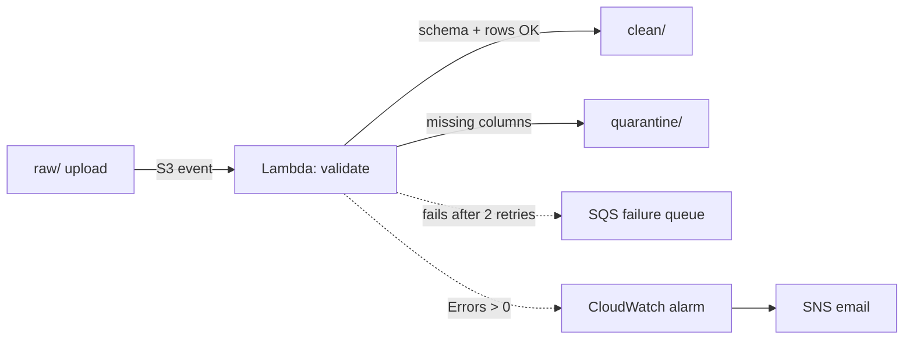
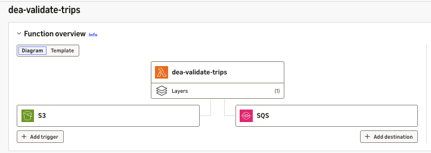
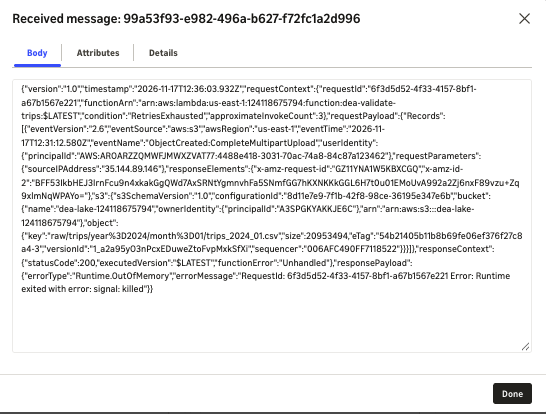

# Build 2: Event-Driven File Validation (S3 + Lambda)

A Lambda function checks every CSV that lands in `raw/` and routes it to `clean/` or
`quarantine/`. Failed runs are retried, then captured in SQS. Errors send an email alarm.

## What I built

| Item | Setting |
|---|---|
| Function | `dea-validate-trips` · Python 3.12 · arm64 · 1024 MB · 1 min timeout · AWS SDK for pandas layer |
| Trigger | S3 all object create events · prefix `raw/trips/` · suffix `.csv` |
| Checks | All 19 expected columns present and at least `MIN_ROWS` rows |
| Failure path | 2 async retries, max event age 1 hour, then on-failure destination SQS `dea-ingest-dlq` |
| Alarm | Lambda `Errors` > 0 in 5 minutes → SNS email |
| Code | [`lambda_function.py`](lambda_function.py) · IAM policy [`iam-policy.json`](iam-policy.json) |

## Design decisions

| Decision | Why |
|---|---|
| S3 event notification, not EventBridge | One consumer and a simple prefix/suffix filter |
| Lambda, not Glue | Small per-file checks that finish in under a second |
| On-failure destination to SQS | Async failures are otherwise dropped; the destination keeps the event and the error |
| Read `raw/`, write other prefixes | The function can't trigger itself |
| Role scoped to `raw/*`, `clean/*`, `quarantine/*` | Least privilege; no access keys anywhere |
| All object create events | Files over 8 MB arrive as multipart uploads, which a Put-only trigger misses |

## What broke (on purpose)

- **Bad file:** dropped the `fare_amount` column. It was routed to `quarantine/` with the missing column logged.
- **Starved memory:** cut memory to 128 MB. The function failed three times (first try plus 2 retries,
  about 1 and 2 minutes apart, same request ID). The event landed in SQS with `RetriesExhausted` and `Runtime.OutOfMemory`,
  and the alarm emailed. At 1024 MB the same file takes 0.6 seconds.

## Cost

Pennies: a few dozen invocations, no hourly resources.
