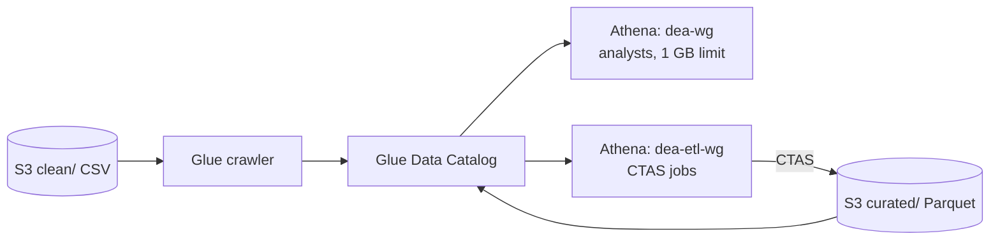
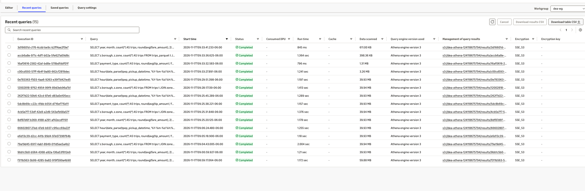
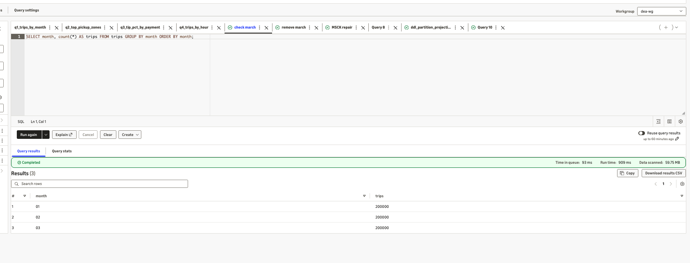

# Build 3: Schema Catalog and SQL Analytics (Glue + Athena)

Cataloged the lake with a Glue crawler, queried it with Athena, converted CSV to partitioned
Parquet, and compared three ways to manage partitions. Two Athena workgroups separate
analyst queries from ETL jobs.

## What I built

| Item | Setting |
|---|---|
| Catalog | Glue database `dea_db`; crawler on `clean/trips/` and `ref/zones/` (add new columns only) |
| Tables | `trips` and `zones` (CSV, from the crawler); `trips_parquet` and `zones_clean` (Parquet, from CTAS) |
| Analyst workgroup | `dea-wg`: result location enforced, SSE-S3, expected bucket owner, 1 GB per-query limit |
| ETL workgroup | `dea-etl-wg`: no client override so CTAS can write to `curated/`, 10 GB per-query limit |
| Partitions | `year`/`month`; tested crawler, `MSCK REPAIR TABLE`, and partition projection |
| SQL | [`queries.sql`](queries.sql) |

## Results: CSV vs Parquet

Same four queries, same answers, before and after converting to Parquet:

| Query | CSV scanned | Parquet scanned | Reduction |
|---|---|---|---|
| Trips and average fare by month | 39.93 MB | 611 KB | ~65x |
| Top 10 pickup zones | 39.94 MB | 398 KB | ~100x |
| Tip % by payment type | 39.93 MB | 1.31 MB | ~30x |
| Trips by pickup hour | 39.93 MB | 3.26 MB | ~12x |

Storage dropped from 19.9 MiB to 5.4 MiB per month. Athena bills per TB scanned, so the same
dashboard query costs up to 100x less.

## Design decisions

| Decision | Why |
|---|---|
| Parquet + Snappy, partitioned by year/month | Reads only needed columns and skips months a query filters out |
| Two workgroups | Analysts get locked settings and a scan cap; ETL jobs can write curated data |
| Partition projection on `trips` | Predictable `year=/month=` layout; no crawler or MSCK needed for new months |
| Cleaned zones with CTAS | The CSV crawler kept literal quote marks in text values |

## What broke and what I found

- **Duplicate file:** February returned 400,000 trips instead of 200,000. A test file from Build 2
  had been validated into `clean/`. Removed it; counts and scan size returned to normal. Athena does
  not warn about duplicates, so row-count checks matter.
- **Quoted values:** zone names came back as `"Manhattan"`. The crawler chose a SerDe that does not
  strip quotes; fixed in the Parquet copy (OpenCSVSerDe is the table-level fix).
- **CTAS blocked:** a workgroup that enforces its result location rejects CTAS with
  `external_location`. Solved with a separate ETL workgroup.
- **Schema drift (on purpose):** loaded an April file with a renamed and an added column. No errors.
  The crawler added both new columns, but they came back empty, while the old column still returned
  values because CSV is read by position. Validation at ingest (Build 2) is the real defense.
- **Data caveat:** cash trips show 0% tips because cash tips are not recorded, not because riders
  don't tip.

## Cost

Pennies: crawler runs and a few hundred MB scanned. Nothing bills hourly.
