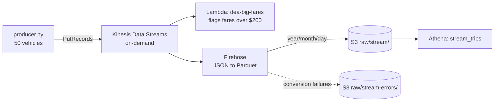
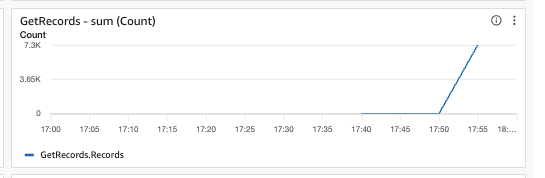

# Build 4: Real-Time Trip Streaming (Kinesis + Firehose)

Simulated taxi trip events stream through Kinesis Data Streams. A Lambda consumer flags
high fares in real time while Firehose converts the same events to Parquet in S3, partitioned
by date and queryable in Athena within about a minute.

## What I built

| Item | Setting |
|---|---|
| Stream | `dea-trip-events`, on-demand capacity |
| Producer | [`producer.py`](producer.py): batches of up to 500 with `put_records`, partition key `vehicle_id`, checks `FailedRecordCount` |
| Real-time consumer | Lambda [`lambda_function.py`](lambda_function.py): Kinesis trigger, batch size 100, skips malformed records instead of failing the batch |
| Delivery | Firehose: record format conversion to Parquet using the Glue table `stream_trips`; prefix `raw/stream/year=/month=/day=`; error prefix for failures; 64 MiB / 60 s buffer |
| Query | Athena table `stream_trips` (Parquet, partitioned by year/month/day) |

## Results

- 5,367 events produced in 3 minutes; all queryable in Athena about a minute after arrival.
- Lambda invoked with whatever was on the shard (for example 22 records, 7 flagged), not waiting
  for a full batch, which keeps latency low.
- Iterator age stayed near 0 ms: the consumer kept up.

## Design decisions

| Decision | Why |
|---|---|
| Data Streams + Firehose together | Streams for real-time processing with replay; Firehose for no-code delivery to the lake |
| `vehicle_id` as partition key | Spreads load across shards and keeps each vehicle's events in order |
| Parquet conversion in Firehose | Lands query-ready, typed data with no extra ETL job |
| Error output prefix | Bad records are kept for review instead of mixing into good data |
| Catch bad records in the consumer | One malformed record cannot stall a shard with endless retries |
| On-demand capacity | No shard sizing for a spiky test workload |

## What broke (on purpose and not)

- **Poison records (on purpose):** sent 10 malformed records. Lambda logged and skipped them; Firehose
  wrote them to `raw/stream-errors/format-conversion-failed/`. Good data stayed clean.
- **IAM propagation:** the first Firehose create failed with "unable to assume role" because its new
  role had not propagated yet; a retry a minute later worked.
- **Small files:** each 60-second flush wrote one small Parquet file per shard (20 to 42 KiB). At scale
  this needs larger buffers or a compaction job.

## Cost

Under $0.10: the stream ran under an hour and was deleted with the Firehose stream right after testing.
