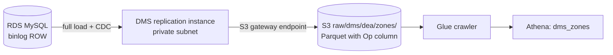
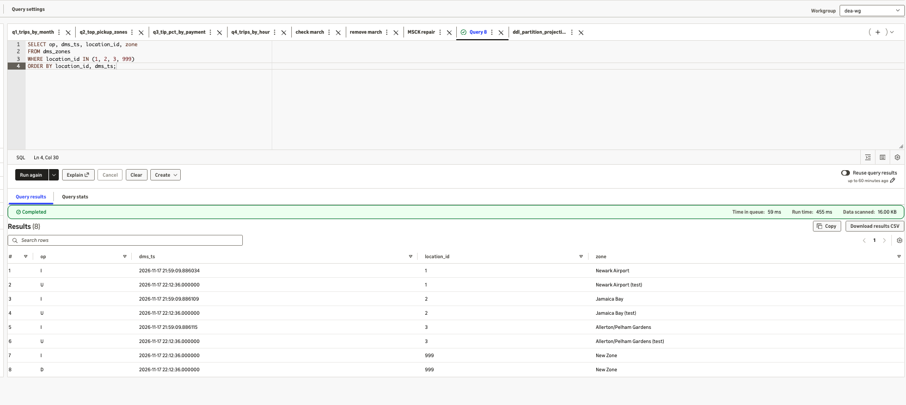
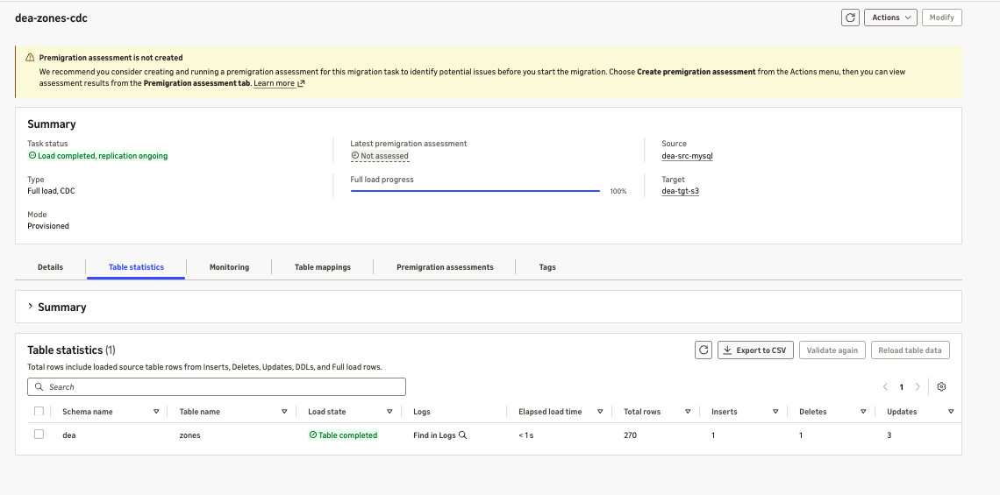

# Build 5: Database Change Capture (RDS MySQL + DMS)

An operational MySQL database replicates into the data lake. DMS copies the table once, then
streams every insert, update and delete from the MySQL binlog to S3 as Parquet. Built almost
entirely from the AWS CLI.

## What I built

| Item | Setting |
|---|---|
| Source | RDS MySQL 8.0, parameter group with `binlog_format=ROW`, `binlog_row_image=FULL`, 24 h binlog retention, password in Secrets Manager |
| Replication | DMS instance (private), source and target endpoints, task `full-load-and-cdc` on `dea.zones` |
| Target | S3 Parquet with `Op` (I/U/D) and `dms_ts` columns; IAM role scoped to `raw/dms/*` ([`dms-s3-policy.json`](dms-s3-policy.json)) |
| Network | Security group allowing my IP and the VPC; S3 gateway VPC endpoint |
| SQL | [`zones.sql`](zones.sql), [`table-mappings.json`](table-mappings.json) |

## Results

- Full load: 265 rows. Changes captured: 3 updates, 1 insert, 1 delete (DMS table statistics: 270 total).
- **Pause test:** stopped the task, made the changes, resumed. Every change arrived, because binlog
  retention kept them until DMS caught up.

## Design decisions

| Decision | Why |
|---|---|
| Full load + CDC | One copy, then only changes: low load on the source, near-real-time lake |
| Parquet with an `Op` column | Downstream jobs can merge inserts, updates and deletes (Build 6 merges this into Iceberg) |
| Private DMS instance + S3 gateway endpoint | No internet path and no NAT cost |
| Secrets Manager for the master password | No password in code; rotation supported |

## What broke and how I fixed it

- **Half the rows loaded, no error:** the source CSV has Windows line endings. With `\n` as the line
  terminator, MySQL merged pairs of lines (133 of 265 rows). Reloaded with `\r\n`. Row-count checks
  caught it.
- **S3 target could not connect:** the private replication instance had no route to S3. Fixed with a
  free S3 gateway endpoint.
- **Instance class retired:** `dms.t3.micro` is no longer offered; listed orderable classes and used
  `dms.t3.small`.
- **Password rotation:** after rotating the secret, DMS refused to resume until its endpoint had the new
  password and passed a connection test.

## Cost

About $0.10: RDS and DMS ran about an hour and were deleted (no final snapshot).
