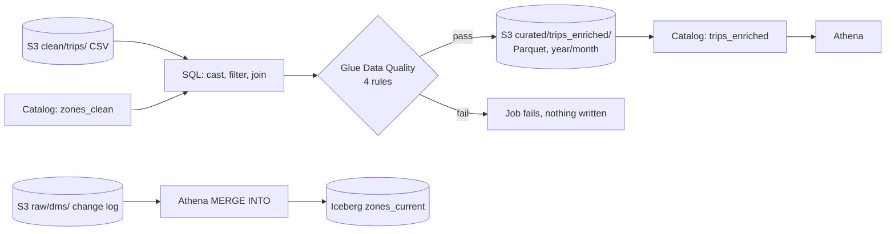
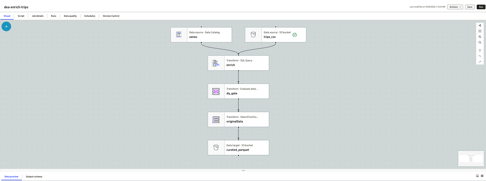
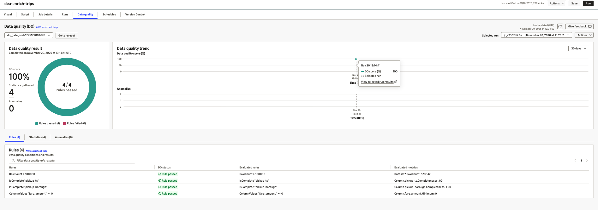
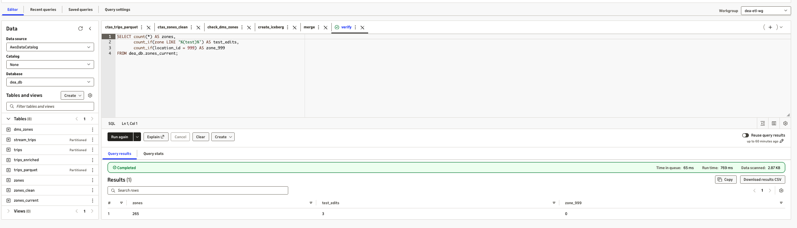

# Build 6: ETL with Data Quality Gates (Glue ETL + Glue Data Quality + Iceberg)

Two transformation patterns on the lake:

1. **Batch ETL with a quality gate:** a Glue Studio job cleans and types the raw trip CSVs, joins zone names,
   checks the result with Glue Data Quality, and only then writes partitioned Parquet and updates the catalog.
2. **CDC to current state:** the DMS change log from Build 5 is merged into an Apache Iceberg table with
   `MERGE INTO`, applying inserts, updates and deletes.

## What I built

| Item | Setting |
|---|---|
| Glue job | `dea-enrich-trips`, Glue Studio visual, Glue 5.0, G.1X × 2 workers, timeout 15 min, job bookmark enabled ([`enrich_trips.py`](enrich_trips.py)) |
| Sources | S3 CSV `clean/trips/` (3 months) and catalog table `zones_clean` |
| Transform | Spark SQL node: casts strings to int/double/timestamp, drops bad rows (no pickup time, negative fare, zero distance), left-joins pickup borough and zone |
| Quality gate | Evaluate Data Quality: `RowCount > 100000`, `IsComplete "pickup_ts"`, `IsComplete "pickup_borough"`, `ColumnValues "fare_amount" >= 0`; on failure: **fail job without loading target data**; results published to CloudWatch |
| Target | Parquet + Snappy, partitioned by `year`, `month`; job creates and updates catalog table `trips_enriched` (no crawler) |
| IAM | Existing role `AWSGlueServiceRole-dea` plus [`glue-policy.json`](glue-policy.json): read `clean/` and `curated/`, write only `curated/trips_enriched/` |
| Iceberg | `zones_current` in `curated/zones_current/`, built with [`queries.sql`](queries.sql) in the ETL workgroup |

## Results

- **578,642** trips written (Jan 193,626 · Feb 193,018 · Mar 191,998), about 3% removed by the filters. All 4 DQ rules passed.
- Every trip got a borough (Manhattan 519,977; Queens 49,912 with the highest average fare, $52.90, because of the airports).
- **Bookmark rerun:** a second run with no new files read nothing and wrote nothing.
- **Iceberg MERGE:** 265 zones, 3 updated, test zone 999 inserted then deleted (absent). Running the MERGE twice gave the same result (idempotent).

## Design decisions

| Decision | Why |
|---|---|
| DQ gate fails the job before writing | Bad or short batches never reach `curated/`; downstream users only see checked data |
| Job bookmarks | Nightly runs process only new files; no duplicates on rerun |
| Catalog updated by the job | New partitions are queryable immediately, no crawler run or cost |
| Parquet partitioned by year/month | Matches the most common filter; Athena reads only the needed months and columns |
| Iceberg + MERGE for CDC | ACID upserts and deletes on S3; reruns are safe |
| Fixed 2 workers, 15-min timeout | Small, predictable cost; a stuck job can't run for the default 8 hours |

## What broke and how I fixed it

- **Lost the job on a browser refresh:** unsaved Glue Studio work is gone. Rebuilt it and saved after every node.
  The new console won't save without a role and defaults to creating a new broad one; chose **Use existing role**.
- **Console defaults didn't match the plan:** Glue 6.0, auto scaling on, 480-minute timeout, DQ "Continue with job".
  Set each one explicitly.
- **The empty rerun failed on schema, not on the DQ rule:** with no new files, a CSV source has no header to read,
  so the SQL step couldn't find `PULocationID` and failed before the gate. Nothing was written either way.
  Production fix: read through a **catalog table** with a fixed schema so an empty batch reaches the DQ rule.

## Cost

About $0.10: two Glue runs of under 2 minutes each at 2 DPUs, plus a few Athena queries.
