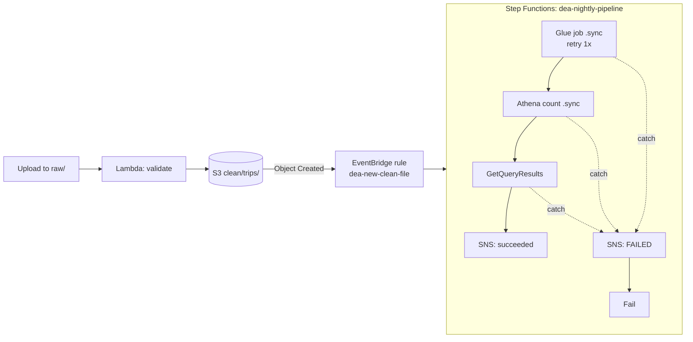
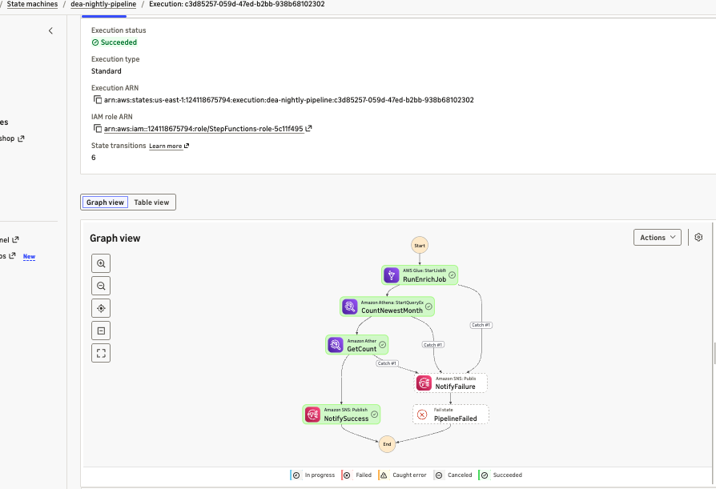
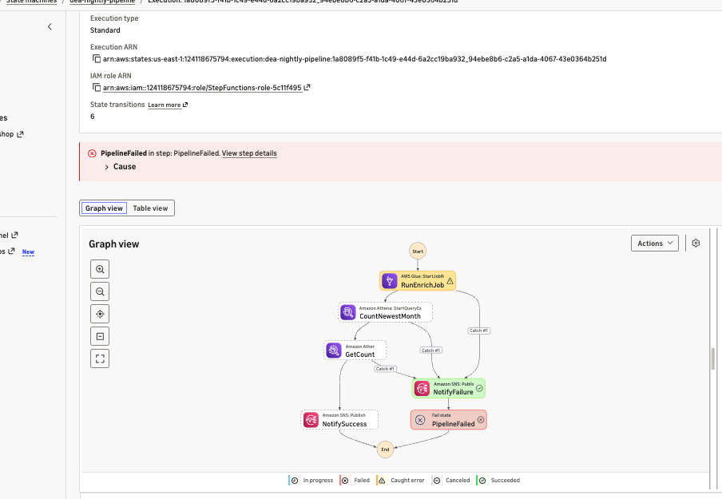

# Build 7: Pipeline Orchestration (Step Functions + EventBridge)

One file upload runs the whole pipeline with no clicks: validation (Build 2), ETL with a data quality gate (Build 6),
a row-count check in Athena, and an email. Failures are retried once, then caught and alerted.

## What I built

| Item | Setting |
|---|---|
| State machine | `dea-nightly-pipeline`, Standard, JSONPath ([`dea-nightly-pipeline.asl.json`](dea-nightly-pipeline.asl.json)) |
| Steps | `glue:startJobRun.sync` → `athena:startQueryExecution.sync` (workgroup `dea-wg`) → `aws-sdk:athena:getQueryResults` → `sns:publish` with `States.Format` |
| Error handling | Retry `States.TaskFailed` once after 30 s; Catch `States.ALL` on every task → failure email → Fail state |
| Trigger | S3 bucket EventBridge notifications on; rule `dea-new-clean-file` ([`event-pattern.json`](event-pattern.json)) targets the state machine. Disabled after testing |
| IAM | Console-generated execution role (templated policy: SNS topic, Athena workgroup, Glue job run); EventBridge role allowed to start only this state machine |

## Results

- **Hands-free run:** uploading April's sample to `raw/` started the execution by itself. Glue processed only April
  (bookmark), Athena counted the newest month, and the email said **194,520 rows** (97% of 200,000). Duration about 3 minutes.
- **Real failure, handled:** the first April run failed in Glue, retried once, failed again, and the Catch sent the
  failure email with the Glue error. Nothing was written.

## Design decisions

| Decision | Why |
|---|---|
| Step Functions over Glue Workflows | Pipeline mixes Glue, Athena and SNS; visual history and per-step retry/catch |
| `.sync` integrations | Step Functions waits for the Glue job and Athena query; no polling Lambda |
| Standard workflow | Runs take minutes, a few times a day; exactly-once and full execution history |
| EventBridge rule on `clean/` | Starts only after validation passes; separate from the Build 2 S3 notification on `raw/` |
| Retry once, then Catch → SNS | Transient errors get a second chance; real failures alert a human |
| Logging off | Standard workflows keep execution history in the console; CloudWatch logging needs extra log-delivery permissions |

## What broke and how I fixed it

- **Real bug found by orchestration:** the first April run failed with `z.locationid cannot be resolved`.
  Glue job bookmarks were tracking the **zones lookup table** as well as trips, so zones read nothing.
  Removed `transformation_ctx` from the zones read (Build 6 script); reran and it succeeded.
- **Logging blocked creation:** "role not authorized to access the Log Destination". Set log level to OFF.
- **New consoles:** templated role policies need parameters filled (topic, workgroup, state machine name);
  EventBridge rules moved under Event buses, and the step-by-step form is "Advanced builder".
- **S3 EventBridge toggle in the console, not the CLI:** the CLI call replaces the bucket's whole notification
  configuration and would have removed the Build 2 Lambda trigger.

## Cost

About $0.10: three Glue runs of about 2 minutes at 2 DPUs; Step Functions and EventBridge are effectively free at this volume.
